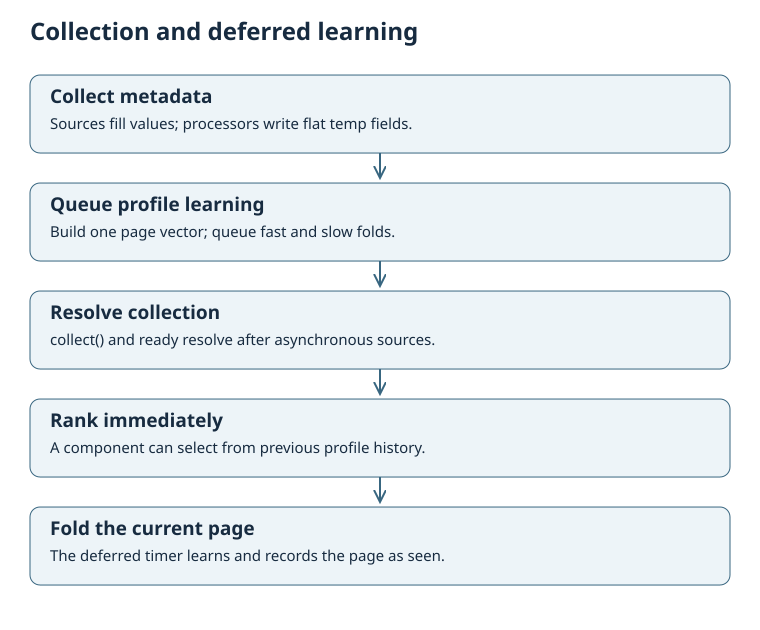
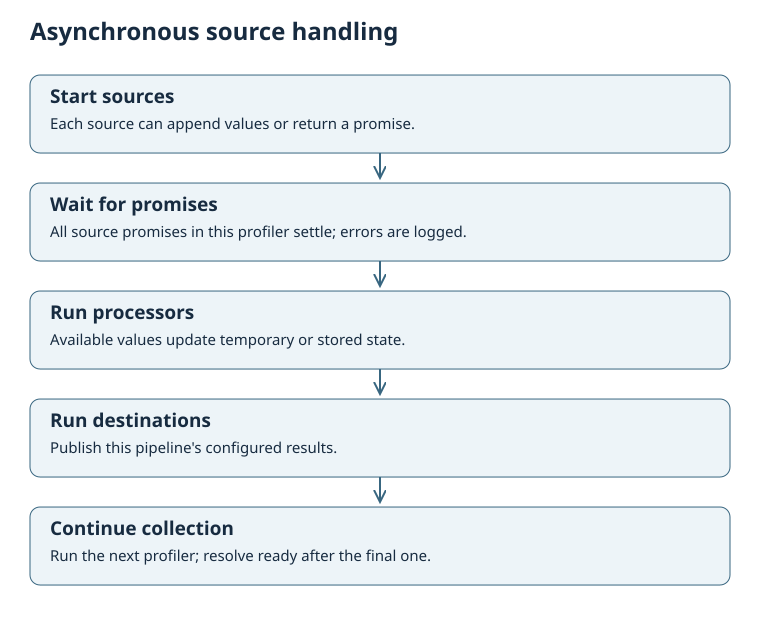

# Collection and learning lifecycle

Collection runs the configured profilers, each with sources, processors and destinations. It prepares the page metadata and queues learning into named profiles. Ranking can run after collection and before that learning is applied.



## Await collection

```javascript
await engine.collect();
const ranked = engine.rank(structuredClone(items), ['fast', 'slow'], 3);
```

`collect()` returns a promise resolving to the engine, and assigns the same promise to `engine.ready`. On a newly constructed engine, `ready` starts as an already-resolved promise: it does not start collection. An integration must call `collect()` before consumers can use `ready` to wait for meaningful work.

Profilers run sequentially in authored object order, or ascending numeric profiler `weight` when `config.order` is `'weight'`. Within one profiler, sources start in configured order; their promises are awaited together before processors and destinations run. Asynchronous values arrive in completion order, so do not rely on the last HTTP response matching the last configured source.



Source errors are logged and collection continues with available values. Unknown plugins are skipped. Processor and destination exceptions are also caught and logged. A successful collection promise does not prove that every configured operation succeeded.

## Prepare all metadata first

`collect()` clears temporary values and current-page state at the start of each run. The first `profile` processor builds the page item and vector from the metadata available at that moment. Later profile processors reuse that page.

Put all metadata profilers before the learning profiler. If using weighted ordering, ensure their profiler weights come first. A profile processor's own `weight` is an engagement multiplier; it does not control pipeline execution order.

## Deferred learning

Profile processors queue folds. After collection resolves, a zero-delay timer folds the current page into the named profiles and marks a non-excluded page ID as seen. This gives ranking called immediately after `await engine.collect()` or `await engine.ready` a chance to use prior history.

An additional asynchronous wait, such as fetching candidates after collection, can allow that timer to run first. If you need ranking before current-page learning, obtain the candidates before collecting, or coordinate both at the integration level. `rank()` itself is synchronous and does not learn its candidates.

`engine.fold()` applies queued folds immediately and is safe to repeat when the queue is empty. Examples and tests use it to finish learning before checking results. A new `collect()` first flushes any previously queued work; repeated collection can therefore learn a page more than once. Call it once per intended page-view event.

## Cached and cancelled work

A profiler with `deferred: true` skips its whole pipeline while `fetchers.<profiler name>.expire` is in the future. The `extreme_geoip` processor writes this cache record. Other processors do not automatically make a deferred profiler cacheable.

A new collection or `erase()` advances the generation. Stale asynchronous completions from an older collection no longer run that collection's processors and destinations. Avoid overlapping collection calls unless the integration deliberately replaces the earlier run.
