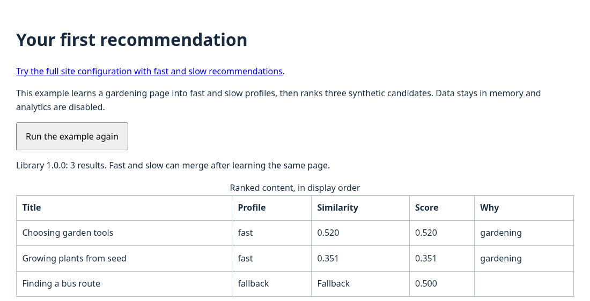

# Your first recommendation

Run a local example that learns an interest in gardening, then uses `rank()` to choose content. Compare its recommendations with the fallback results shown before a visitor has a profile. Both use the same candidate list, which contains the content available to recommend.

## Before you start

You need Git, Node.js 22.12 or newer, npm and a modern browser. Basic JavaScript knowledge is useful for the browser-console steps. This tutorial uses synthetic content and keeps profile data in memory; it does not require Drupal or an analytics service. To install on your own pages, follow [Add the library to your site](../usage/browser.md).

## 1. Build and start the example

Clone [morpht/convivial-personalisation](https://github.com/morpht/convivial-personalisation) and enter its directory. If you already have a local checkout, start from that directory and skip these two commands.

```bash
git clone https://github.com/morpht/convivial-personalisation.git
cd convivial-personalisation
```

Install the build dependencies, build the browser bundle and start the example server:

```bash
npm ci
npm run build
npm run dev
```

Leave the development server running. Open http://127.0.0.1:8080/example/. If port 8080 is occupied, run `npm run dev -- --port=8081` and use that port in the URL instead.

You should see **Your first recommendation**, a table of three results and a profile snapshot. The status message identifies library version `1.0.0`.



## 2. Inspect what the page learned

The example page supplies this metadata:

```html
<meta name="nid" content="page-gardening">
<meta name="title" content="Growing a garden">
<meta name="topics" content="gardening|Gardening">
```

Its [configuration](../configuration/profilers.md#complete-small-configuration) collects the values into `temp.nid`, `temp.title` and `temp.topics`, then learns two named profiles: `fast` and `slow`. The example explicitly calls `fold()` to finish learning before displaying its results.

In the profile snapshot, find `profiles.fast` and `profiles.slow`. Both should have confidence close to `1`. In the result table, gardening content should appear first. Selected rows can all use the `fast` label because these newly learned profiles point in the same direction and merge for selection.

## 3. Call rank() yourself

Open the browser's developer console on the example page and run:

```javascript
const engine = window.convivialPersonalisation;
const items = [
  { nid: 'garden-tools', title: 'Choosing garden tools', topics: 'gardening', url: '/garden-tools' },
  { nid: 'bus-routes', title: 'Finding a bus route', topics: 'transport', url: '/bus-routes' },
  { nid: 'garden-seeds', title: 'Growing plants from seed', topics: 'gardening', url: '/garden-seeds' }
];
const results = engine.rank(structuredClone(items), ['fast', 'slow'], 3, {
  priorityWeight: 0,
  diversify: false,
  block: 'tutorial-recommendations'
});
console.table(results.map(({ id, profile, sim, pos }) => ({ id, profile, sim, pos })));
```

This uses the engine already created by the example. `structuredClone(items)` gives ranking its own copy because it adds result fields to the rows. `priorityWeight: 0` makes profile selection depend on similarity, and `diversify: false` keeps the selection order visible.

Check the output:

| Field | What to look for |
| --- | --- |
| `id` | One of the three candidate IDs |
| `profile` | `fast` for a learned selection, or `fallback` when filling a remaining slot |
| `sim` | A number for a learned match; `null` for fallback |
| `pos` | Display positions 1, 2 and 3 |

Gardening content should appear first. Scores include both text and topic features, so rows with the same topic can have different scores.

## 4. Compare fallback

In the same console, request no learned profiles:

```javascript
console.table(engine.rank(structuredClone(items), [], 3).map(
  ({ id, profile, sim, pos }) => ({ id, profile, sim, pos })
));
```

All three rows should now have `profile: 'fallback'` and `sim: null`. With the default priority, their order is `garden-tools`, `bus-routes`, `garden-seeds`. This is also how a first visit can receive useful content before a usable profile exists.

Click **Run the example again** to create a fresh in-memory engine and restore the example's result table. Stop the server with Ctrl+C when finished.

## Continue

[Compare fast and slow recommendations](../usage/fast-and-slow.md) to observe changing interests over time. To integrate the library, [add it to your site](../usage/browser.md) and [build a recommendation block](../usage/recommendations.md).

If results are missing, begin with [troubleshooting](../support/troubleshooting.md). Normal integrations let the library schedule page learning after collection; the tutorial's explicit `fold()` is explained in [the collection lifecycle](../concepts-and-tools/data-pipelines.md).
