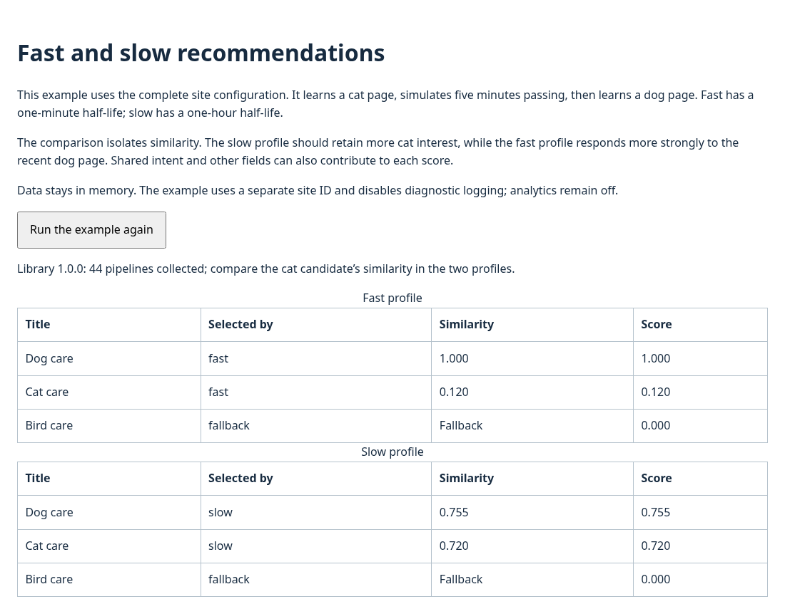

# Compare fast and slow recommendations

Learn a cat page, simulate five minutes passing, then learn a dog page. You will see the fast profile respond more strongly to the recent page while the slow profile retains more of the earlier interest.

## Before you start

Complete [your first recommendation](../getting-started/installation.md), or have the repository built and its development server running. This tutorial uses the [real site configuration](../configuration/site-example.md) with synthetic pages about cats, dogs and birds.

The configured half-lives are 60 seconds for `fast` and 3,600 seconds for `slow`. A half-life is the time it takes an old contribution to lose half its strength. Profile names do not impose these values.

## 1. Run the browsing sequence

From the repository root, start the example server if it is not already running:

```bash
npm run dev
```

Open http://127.0.0.1:8080/example/site.html. The example automatically learns the cat page, advances its injected clock by 300 seconds, then learns the dog page. You do not need to wait five real minutes.

You should see three result tables: **Fast profile**, **Slow profile**, and **Requested slots: two fast, one slow**. The status confirms that all 44 pipelines ran. Profile data stays in memory under a separate example site ID, and analytics and diagnostic logging are disabled.

## 2. Compare the results

Find **Cat care** and **Dog care** in the first two tables:



| Observation | Expected result |
| --- | --- |
| Leading fast recommendation | Dog care, the most recently learned interest |
| Cat care's similarity | Higher in the slow table than in the fast table |
| Slow profile's first result | May still be Dog care; slow does not mean always recommending older content |
| Selected by | A profile name, or `fallback` for an eligible row filling an unused slot |

After five minutes, the original cat contribution has retained `1/32` of its fast strength and about `0.944` of its slow strength. The second page then contributes to both profiles. Shared intent, stage and type fields can make different topics partly similar too.

In **Current profile snapshot**, confirm that `profiles.fast.decay` is `60` and `profiles.slow.decay` is `3600`. Click **Run the example again** to repeat the same simulation with a fresh engine.

## 3. Request your own allocation

Open the browser console on this example page and run:

```javascript
const engine = window.convivialPersonalisation;
const { candidates } = await import('/example/site-scenario.js');
const results = engine.rank(structuredClone(candidates), { fast: 2, slow: 1 }, 3, {
  block: 'tutorial-mixed',
  priorityWeight: 0,
  diversify: false
});
console.table(results.map(({ id, profile, sim, pos }) => ({ id, profile, sim, pos })));
```

The request asks for two result slots from `fast` and one from `slow`. It does not average the two vectors. Similar profiles can merge, and earlier selections take rows before later profiles select. Fallback can fill unoccupied slots. The returned `profile` and `pos` show what actually happened.

`priorityWeight: 0` isolates similarity for profile selection. Try `0.8` and compare the selected rows and their positions: the original candidate order now has more influence, while the minimum similarity requirement still applies.

## Use your own content

This example calls `fold()` to finish learning before displaying results. A site integration normally uses the [deferred learning lifecycle](../concepts-and-tools/data-pipelines.md).

Follow [build a recommendation block](recommendations.md) to connect your feed. The [rank() reference](../reference/rank.md) lists the available controls, and [fast and slow profiles](../concepts-and-tools/fast-and-slow-profiles.md) explains the decay calculation.
